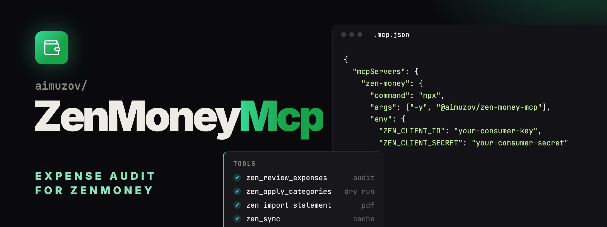

<p align="center">
	
	<a href="README.ru.md"></a>
</p>

<p align="center">
	
</p>

<p align="center">
	<a href="https://github.com/aimuzov/zen-money-mcp/actions/workflows/check.yml"></a>
	<a href="https://github.com/aimuzov/zen-money-mcp/releases"></a>
	<a href="package.json"></a>
	<a href="https://modelcontextprotocol.io"></a>
	<a href="LICENSE"></a>
</p>

<h3 align="center">ZenMoney expense audit with Claude</h3>
<p align="center">Categories from the history of each place, writes only after a preview, Ozon Bank statement import</p>

An MCP server for [ZenMoney](https://zenmoney.ru): it audits expenses, finds transactions with no category or a doubtful one, fixes categories and imports the missing transactions from an Ozon Bank PDF statement. Claude makes the call in the conversation, the server gives it the history and the candidates.

## How it works

```
Claude ──MCP/stdio──▶ zen-money-mcp ──HTTPS──▶ ZenMoney API (diff v8)
                            │
                            ▼
                 local cache in node:sqlite
             the whole history, then only changes
```

- The ZenMoney history is loaded into a local cache once, then only changes are pulled.
- The server doesn't pick a category itself. From the history of the place (merchant, then payee, then MCC) it ranks candidates with a confidence, weighing recency, the day of week and the amount range. Claude picks.
- Nothing is written without a confirmation: the writing tools default to a preview (`dryRun: true`).

## Tools

| Tool                    | What it does                                                                                             |
| ----------------------- | -------------------------------------------------------------------------------------------------------- |
| `zen_sync`              | Pulls changes into the cache, `full: true` refetches the whole history                                   |
| `zen_list_categories`   | Categories with their hierarchy and paths, `kind`: expenses, income or all                               |
| `zen_find_transactions` | Search by period, account, merchant, payee, MCC, uncategorized or doubtful                               |
| `zen_merchant_history`  | The whole category history of a place: counts, amounts, examples                                         |
| `zen_review_expenses`   | Audit of a period: uncategorized or suspicious expenses with ranked candidates                           |
| `zen_apply_categories`  | Writes categories, shows "before → after" first                                                          |
| `zen_import_statement`  | Imports an Ozon Bank PDF statement: duplicates by date and amount are skipped, new ones have no category |

A typical session: "Check my expenses for last week". Claude calls `zen_sync` and `zen_review_expenses`, suggests fixes, `zen_apply_categories` with `dryRun: true` shows the changes, and after your "yes" the same call with `dryRun: false` writes them.

## Setup

Node 26 or newer: the cache lives in the built-in `node:sqlite`.

1. Register an OAuth app at [developers.zenmoney.ru](https://developers.zenmoney.ru) (or `.app`) and get its consumer key and secret. Its redirect URI is `http://localhost:53682/callback`.
2. Sign in once in a terminal:

    ```bash
    ZEN_CLIENT_ID=… ZEN_CLIENT_SECRET=… npx -y @aimuzov/zen-money-mcp auth
    ```

    A browser opens, and after sign-in the token is saved to the data directory. It refreshes itself afterwards.

3. Add the server to your MCP config, see [.mcp.json.example](.mcp.json.example):

    ```json
    {
    	"mcpServers": {
    		"zen-money": {
    			"command": "npx",
    			"args": ["-y", "@aimuzov/zen-money-mcp"],
    			"env": {
    				"ZEN_CLIENT_ID": "your-consumer-key",
    				"ZEN_CLIENT_SECRET": "your-consumer-secret",
    				"ZEN_ENDPOINT": "ru"
    			}
    		}
    	}
    }
    ```

Without a token the tools answer with a hint to run `zen-money-mcp auth`. There is no hosted connector: the server runs over stdio only and the data stays on your machine.

## Commands

```
Usage: zen-money-mcp [serve|auth|sync [--full]|--help|--version]

  serve   run the MCP server over stdio (default)
  auth    sign in to ZenMoney in the browser and save the token
  sync    pull changes from ZenMoney into the local cache, --full refetches everything
```

## Environment

| Variable                             | Default                   | What it does                                                                                                  |
| ------------------------------------ | ------------------------- | ------------------------------------------------------------------------------------------------------------- |
| `ZEN_CLIENT_ID`, `ZEN_CLIENT_SECRET` |                           | The OAuth app, needed to sign in and refresh                                                                  |
| `ZEN_ENDPOINT`                       | `ru`                      | `ru` is api.zenmoney.ru, `app` is api.zenmoney.app                                                            |
| `ZEN_REDIRECT_PORT`                  | `53682`                   | Port of the `http://localhost:<port>/callback`                                                                |
| `ZEN_REDIRECT_URI`                   |                           | The full callback URI when the app has another one                                                            |
| `ZEN_DATA_DIR`                       | `~/.config/zen-money-mcp` | The `cache.sqlite` cache and the `auth.json` token                                                            |
| `LOG_LEVEL`                          | `info`                    | `error`, `warn`, `info` or `debug`                                                                            |
| `SENTRY_DSN`                         |                           | [Error reports](https://github.com/aimuzov/infra-mcp-kit#sentry) to Sentry, release `zen-money-mcp@<version>` |

They may also live in `.env` at the package root, the environment wins over the file.

## Development

```bash
npm start               # the server over stdio straight from src/
npm test                # node --test
npm run typecheck
npm run lint
npm run format          # oxlint --fix and prettier
npm run build           # build/ for npm
```

Shared helpers and the CI steps come from [infra-mcp-kit](https://github.com/aimuzov/infra-mcp-kit), formatting and lint rules from [infra-site-kit](https://github.com/aimuzov/infra-site-kit). Times in the cache are Unix seconds, like in the API.

## License

[MIT](LICENSE)
