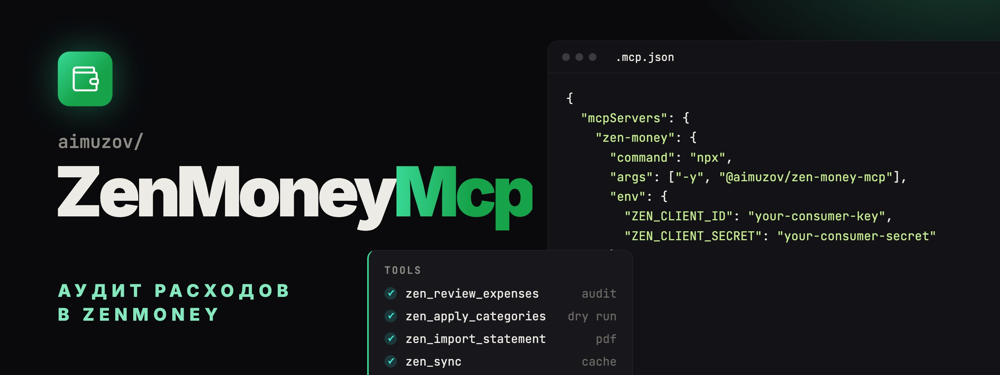

<p align="center">
	<a href="README.md"></a>
	
</p>

<p align="center">
	
</p>

<p align="center">
	<a href="https://github.com/aimuzov/zen-money-mcp/actions/workflows/check.yml"></a>
	<a href="https://github.com/aimuzov/zen-money-mcp/releases"></a>
	<a href="package.json"></a>
	<a href="https://modelcontextprotocol.io"></a>
	<a href="LICENSE"></a>
</p>

<h3 align="center">Аудит расходов ZenMoney вместе с Claude</h3>
<p align="center">Категории по истории каждого места, запись только после предпросмотра, импорт выписки Озон Банка</p>

MCP-сервер для [ZenMoney](https://zenmoney.ru): проверяет расходы, находит операции без категории или с сомнительной категорией, исправляет категории и дозагружает операции, которых нет, из PDF-выписки Озон Банка. Решение принимает Claude в разговоре, сервер даёт ему историю и кандидатов.

## Как это работает

```
Claude ──MCP/stdio──▶ zen-money-mcp ──HTTPS──▶ ZenMoney API (diff v8)
                            │
                            ▼
                 локальный кэш на node:sqlite
          вся история, дальше синхронизация изменений
```

- История ZenMoney один раз загружается в локальный кэш, дальше подтягиваются только изменения.
- Категорию сервер сам не выбирает. По истории места (мерчант, затем получатель, затем MCC) он считает кандидатов с уверенностью, учитывая свежесть, день недели и диапазон суммы. Выбирает Claude.
- Запись идёт только после подтверждения: инструменты записи по умолчанию работают в режиме предпросмотра (`dryRun: true`).

## Инструменты

| Инструмент              | Что делает                                                                                |
| ----------------------- | ----------------------------------------------------------------------------------------- |
| `zen_sync`              | Подтягивает изменения в кэш, `full: true` перекачивает всю историю                        |
| `zen_list_categories`   | Категории с иерархией и путями, `kind`: расходы, доходы или все                           |
| `zen_find_transactions` | Поиск по периоду, счёту, мерчанту, получателю, MCC, без категории или под вопросом        |
| `zen_merchant_history`  | Вся история категорий по месту: частоты, суммы, примеры                                   |
| `zen_review_expenses`   | Аудит расходов за период: без категории или подозрительные, с кандидатами                 |
| `zen_apply_categories`  | Записывает категории, сначала показывает «было → стало»                                   |
| `zen_import_statement`  | Импорт из PDF-выписки Озон Банка: дубли по дате и сумме пропускаются, новые без категории |

Типичный сценарий: «Проверь мои расходы за прошлую неделю». Claude вызывает `zen_sync` и `zen_review_expenses`, предлагает исправления, `zen_apply_categories` с `dryRun: true` показывает изменения, а после твоего «да» тот же вызов с `dryRun: false` их записывает.

## Установка

Нужен Node 26 или новее: кэш живёт во встроенном `node:sqlite`.

1. Зарегистрируй OAuth-приложение на [developers.zenmoney.ru](https://developers.zenmoney.ru) (или `.app`) и получи consumer key и consumer secret. Redirect URI приложения — `http://localhost:53682/callback`.
2. Войди один раз в терминале:

    ```bash
    ZEN_CLIENT_ID=… ZEN_CLIENT_SECRET=… npx -y @aimuzov/zen-money-mcp auth
    ```

    Откроется браузер, после входа токен сохранится в каталог данных. Дальше он обновляется сам.

3. Добавь сервер в конфиг MCP, см. [.mcp.json.example](.mcp.json.example):

    ```json
    {
    	"mcpServers": {
    		"zen-money": {
    			"command": "npx",
    			"args": ["-y", "@aimuzov/zen-money-mcp"],
    			"env": {
    				"ZEN_CLIENT_ID": "your-consumer-key",
    				"ZEN_CLIENT_SECRET": "your-consumer-secret",
    				"ZEN_ENDPOINT": "ru"
    			}
    		}
    	}
    }
    ```

Без токена инструменты отвечают подсказкой выполнить `zen-money-mcp auth`. Размещённого коннектора нет: сервер работает только по stdio, данные остаются на твоей машине.

## Команды

```
Usage: zen-money-mcp [serve|auth|sync [--full]|--help|--version]

  serve   run the MCP server over stdio (default)
  auth    sign in to ZenMoney in the browser and save the token
  sync    pull changes from ZenMoney into the local cache, --full refetches everything
```

## Переменные окружения

| Переменная                           | По умолчанию              | Что делает                                                                                                                           |
| ------------------------------------ | ------------------------- | ------------------------------------------------------------------------------------------------------------------------------------ |
| `ZEN_CLIENT_ID`, `ZEN_CLIENT_SECRET` |                           | OAuth-приложение, нужно для входа и обновления токена                                                                                |
| `ZEN_ENDPOINT`                       | `ru`                      | `ru` — api.zenmoney.ru, `app` — api.zenmoney.app                                                                                     |
| `ZEN_REDIRECT_PORT`                  | `53682`                   | Порт колбэка `http://localhost:<port>/callback`                                                                                      |
| `ZEN_REDIRECT_URI`                   |                           | Полный URI колбэка, если в приложении он другой                                                                                      |
| `ZEN_DATA_DIR`                       | `~/.config/zen-money-mcp` | Кэш `cache.sqlite` и токен `auth.json`                                                                                               |
| `LOG_LEVEL`                          | `info`                    | `error`, `warn`, `info` или `debug`                                                                                                  |
| `SENTRY_DSN`                         |                           | [Отчёты об ошибках](https://github.com/aimuzov/infra-mcp-kit/blob/main/README.ru.md#sentry) в Sentry, релиз `zen-money-mcp@<версия>` |

Переменные можно положить в `.env` в корне пакета, окружение главнее файла.

## Разработка

```bash
npm start               # сервер на stdio прямо из src/
npm test                # node --test
npm run typecheck
npm run lint
npm run format          # oxlint --fix и prettier
npm run build           # build/ для npm
```

Общие хелперы и шаги CI берутся из [infra-mcp-kit](https://github.com/aimuzov/infra-mcp-kit), правила форматирования и линтера — из [infra-site-kit](https://github.com/aimuzov/infra-site-kit). Время в кэше хранится в Unix-секундах, как в API.

## Лицензия

[MIT](LICENSE)
